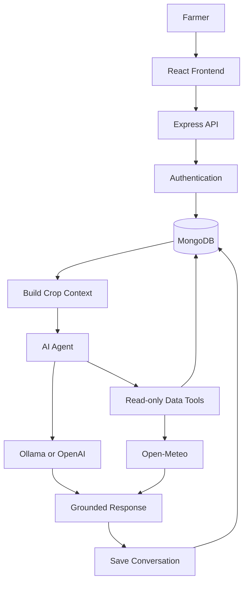

<div align="center">

# 🌱 AGRO — AI Farming Companion

### Your Smart, AI-Powered Farming Assistant

Helping farmers make informed crop decisions through
AI-powered insights, farm records, and weather data.


</div>

---

## 📖 Table of Contents

- [About AGRO](#-about-agro)
- [The Problem](#-the-problem)
- [Our Solution](#-our-solution)
- [Key Features](#-key-features)
- [AI Agent](#-ai-agent)
- [Technology Stack](#-technology-stack)
- [Requirements](#-requirements)
- [Installation](#-installation)
- [System Architecture](#-system-architecture)
- [Testing](#-testing)
- [Security and Privacy](#-security-and-privacy)
- [Limitations](#-limitations)
- [Team Contribution](#-team-contribution)

---

## 🌾 About AGRO

AGRO is an AI-powered farming companion that helps farmers
manage crop information, record farm observations, explore
weather conditions, and ask crop-specific questions.

Its AI assistant can retrieve saved crop history, actual
measurements, and local weather forecasts when relevant.

> Better-informed farming starts with better information.

## 🎯 The Problem

- Generic farming advice may not reflect local conditions.
- Crop observations and measurements can be difficult to track.
- Farm information may be scattered across different sources.
- Unsupported assumptions can lead to poor farming decisions.

## 💡 Our Solution

AGRO combines farm records, crop-specific AI chat, measurement
charts, and external weather data in one application.

The assistant uses restricted, read-only tools to retrieve
relevant information before answering when appropriate.

## ✨ Key Features

### 👨‍🌾 Farm Management
- Private farmer accounts
- Farm profiles and location coordinates
- Crop profiles and planting information

### 🌦️ Weather and Measurements
- Current weather and five-day forecasts
- Historical climate information
- Crop journals and measurement charts

### 🤖 AI Farming Assistant
- Crop-specific conversations
- AI-powered crop-planning suggestions
- Crop history and measurement retrieval
- Local Ollama and optional OpenAI support

### 🖼️ Multimodal Support
- Crop-photo analysis
- PDF, DOCX, TXT, CSV, and Markdown files
- Local voice transcription
- Browser-based spoken answers

### 🌐 Languages
- English
- Sinhala
- Tamil

## 🛠️ Technology Stack

| Component | Technology |
|---|---|
| Frontend | React, Vite, JavaScript |
| Backend | Node.js, Express |
| Database | MongoDB, Mongoose |
| AI | Ollama, optional OpenAI API |
| Weather | Open-Meteo |
| Maps | Google Maps Platform |
| Authentication | bcryptjs, JWT |
| Testing | Automated backend tests |

## 📋 Requirements

- Node.js 20.16+ or 22.3+
- npm
- MongoDB local server or Atlas
- Ollama or an OpenAI API key with available credits
- Optional Google Maps API key

## 🚀 Installation

### 1. Configure the Backend

```powershell
cd backend
npm.cmd install
Copy-Item .env.example .env
```

Configure `backend/.env` with your database connection,
a private JWT secret, and your chosen AI provider.

### 2. Start the Backend

```powershell
npm.cmd run dev
```

API: http://localhost:5000

Health check: http://localhost:5000/api/health

### 3. Start the Frontend

Open a second terminal:

```powershell
cd frontend
npm.cmd install
npm.cmd run dev
```

Open the local URL printed by Vite, usually:

http://localhost:5173

## 🏗️ System Architecture



## 🧪 Testing

Run backend tests:

```powershell
cd backend
npm.cmd test
```

Latest reported local verification (18 October 2026):
- 16 backend tests passed.
- Frontend production build succeeded.
- npm audit reported zero vulnerabilities.
- Backend health endpoint and local AI services responded
  successfully in the development environment.

These results do not certify a production deployment.

## 🔐 Security and Privacy

- Passwords are hashed.
- JWT-based authentication is used.
- Crop records and attachments are associated with the owner.
- AI data tools are read-only and restricted.
- Uploads are limited to 10 MB per file.

Before public deployment, review authorization, file validation,
secret management, backups, rate limiting, and privacy controls.

## ⚠️ Limitations

AGRO is a hackathon MVP, not a validated agricultural
diagnostic system.

AI recommendations may be inaccurate. Weather data represents
a nearby grid location rather than direct field measurements.
A regular photograph cannot reliably determine soil pH or
nutrient levels.

Confirm important crop, disease, fertilizer, and pesticide
decisions with qualified local agricultural experts.

## 👩‍💻 Team Contribution

**U. G. Harshani Sandunika Ranasingha — Individual Contributor**

Full-stack implementation covering the frontend, backend,
database integration, crop and weather features, AI assistant,
and testing.

Update this statement if the final contribution differs.

---

<div align="center">

🌱 **AGRO — Your Smart AI Farming Companion**

Built for the AGRO AI Hackathon | October 2026

</div>
